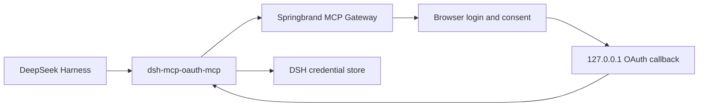

# dsh-mcp-oauth-mcp

An OAuth 2.1 Streamable HTTP MCP client plugin for DeepSeek Harness. It keeps
the native `dsh-mcp-client` tool discovery, registration, execution, and
reconnection behavior while adding MCP SDK OAuth, PKCE, dynamic client
registration, browser authorization, a loopback callback, and token storage.

The bundled configuration connects to the Springbrand production Gateway at
`https://connector.springbrand.ai/mcp`. This package can be installed
directly from a local checkout and does not depend on a plugin marketplace.



## Local installation

Build the plugin:

```sh
cd /Users/yzend/code/springbrand/dsh-mcp-oauth-mcp
pnpm install
pnpm build
```

Install it into the DSH `web` profile:

```sh
cd /Users/yzend/code/deepseek-harness-pro
pnpm dsh plugin --profile web add /Users/yzend/code/springbrand/dsh-mcp-oauth-mcp
pnpm dsh web
```

The first startup opens the default browser. After Springbrand login and
consent, DSH registers these tools:

- `mcp__springbrand__search_capabilities`
- `mcp__springbrand__execute_capability`

OAuth tokens, dynamic registration data, and the discovery cache are stored
through the DSH credential service under `SPRINGBRAND_MCP_OAUTH_PRODUCTION` in
the bundled production configuration.
Do not add an `Authorization` header to the YAML configuration.

## Configuration

The default configuration is in
[`springbrand.cordis.yml`](./springbrand.cordis.yml):

| Field | Description | Default |
| --- | --- | --- |
| `serverName` | Namespace used for MCP tool names | Required |
| `url` | HTTPS Streamable HTTP MCP endpoint | Required |
| `credentialRef` | DSH credential reference | `DSH_MCP_OAUTH_<SERVER>` |
| `scope` | Optional OAuth scope | Discovered from the server |
| `callbackPort` | Loopback callback port; `0` chooses a free port | `0` |
| `authorizationTimeoutMs` | Browser authorization timeout | `300000` |
| `toolCallTimeoutMs` | Timeout for one MCP tool call | `60000` |
| `failOnStartupError` | Fail activation when the first connection fails | `true` |
| `reconnect` | Exponential reconnect policy | Enabled |

The plugin currently supports Streamable HTTP and MCP tools only. It does not
include stdio, resources, prompts, or marketplace publication configuration.

## Development checks

```sh
pnpm test
pnpm typecheck
pnpm build
```

`src/connection.ts` and `src/tools.ts` are adapted from DeepSeek Harness
`@deepseek-ai/dsh-mcp-client` under the MIT License.
