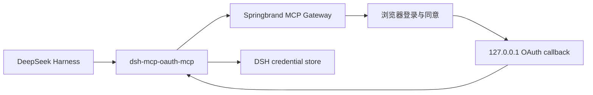

# dsh-mcp-oauth-mcp

DeepSeek Harness 的 OAuth 2.1 Streamable HTTP MCP 客户端插件。它基于原生
`dsh-mcp-client` 的工具发现、工具注册和重连逻辑，增加了 MCP SDK 原生 OAuth、PKCE、
动态客户端注册、浏览器授权、loopback callback 和 token 持久化。

当前 bundle 默认连接 Springbrand dev Gateway：
`https://devconnector.springbrand.ai/mcp`。它是本地可安装 bundle，不依赖任何插件市场。



## 本地安装

先构建插件：

```sh
cd /Users/yzend/code/springbrand/dsh-mcp-oauth-mcp
pnpm install
pnpm build
```

再安装到 DSH 的 `web` profile：

```sh
cd /Users/yzend/code/deepseek-harness-pro
pnpm dsh plugin --profile web add /Users/yzend/code/springbrand/dsh-mcp-oauth-mcp
pnpm dsh web
```

首次启动会打开默认浏览器。完成 Springbrand 登录和同意后，DSH 会注册：

- `mcp__springbrand__search_capabilities`
- `mcp__springbrand__execute_capability`

OAuth token、动态注册信息和 discovery cache 写入 DSH credential service，默认引用名为
`SPRINGBRAND_MCP_OAUTH`；不要在 YAML 中手写 `Authorization` header。

## 配置

默认配置在 [`springbrand.cordis.yml`](./springbrand.cordis.yml)。必要时可修改：

| 字段 | 说明 | 默认值 |
| --- | --- | --- |
| `serverName` | MCP 工具命名空间 | 必填 |
| `url` | HTTPS Streamable HTTP MCP 地址 | 必填 |
| `credentialRef` | DSH credential 引用 | `DSH_MCP_OAUTH_<SERVER>` |
| `scope` | 可选 OAuth scope | 由服务端发现 |
| `callbackPort` | 本机 callback 端口，`0` 为随机端口 | `0` |
| `authorizationTimeoutMs` | 等待浏览器授权的时间 | `300000` |
| `toolCallTimeoutMs` | 单次 MCP tool call 超时 | `60000` |
| `failOnStartupError` | 首次连接失败时阻止插件启动 | `true` |
| `reconnect` | 断线指数退避策略 | 启用 |

限制：目前只支持 Streamable HTTP 和 MCP tools；不包含 stdio、resources、prompts 或市场发布配置。

## 开发检查

```sh
pnpm test
pnpm typecheck
pnpm build
```

`src/connection.ts` 和 `src/tools.ts` 改编自 DeepSeek Harness 的
`@deepseek-ai/dsh-mcp-client`，依照 MIT License 使用。
